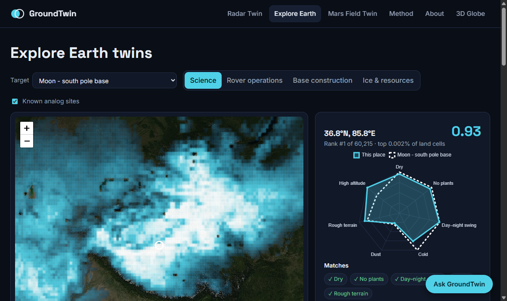

# GroundTwin — Earth as the twin of the Moon and Mars

NASA Space Apps Challenge 2026 · Team **Code Influence** (Kazakhstan) · Challenge: Identify Earth Locations that Analog the Permanent Moon Base Locations and Mars



**Website:** https://zhureswe.github.io/groundtwin/ · **3D globe:** https://zhureswe.github.io/groundtwin/embed/globe.html · **Paper (PDF):** [paper/groundtwin_paper.pdf](paper/groundtwin_paper.pdf) · **Demo:** [link to be added]

GroundTwin uses Earth as the twin of the Moon and Mars. First and foremost, our Analog Engine scores all 60,215 land cells on Earth against a lunar south-pole profile and two Mars crater profiles, using seven features from NASA data. For each place it shows what matches, what does not, and what Earth can never reproduce. Tested on known analog sites, it recognised 7 of 11 Mars analogs in a blind test. Mangystau in Kazakhstan, the floor of a vanished sea, ranks in the top 9.5% of Earth's land cells for Gale crater. Second, Canada's RCM radar shares the design of NASA's Mini-RF, so we check radar ice signatures on Earth, where the truth is known. We then combine Mini-RF, LOLA and Diviner into an Ice Evidence Score for south-pole craters that helps choose where a lunar base could find ice. Everything is open and traceable to data.

## Two directions

### 1. Earth analogs of the Moon and Mars (main)
- **Analog Engine.** Each of Earth's 60,215 land cells (0.5°) gets percentiles for 7 features from NASA data: dryness, no plants, day–night swing, cold, dust, roughness and elevation. The score is s_i = 1 − |p_i − t_i| and S = Σ w_i s_i / Σ w_i, with a target profile t and mission-mode weights w. Scores are computed live in the browser.
- **Validation.** We use 16 known analog sites from the NASA Planetary Analog Explorer and USGS.
  - Average rank of known Mars analogs: top 21.3% for Gale (p = 0.001) and top 24.4% for Jezero (p = 0.003); a random place averages ≈ 50%.
  - Blind leave-one-out test: 7 of 11 recognised (chance ≈ 1.1, p = 2e-05).
  - Lift in the top 10% is weak (Gale ×0.91, Jezero ×0.00). We report this openly.
- **Mangystau (Kazakhstan) as a Mars field twin.** It is the floor of the ancient Tethys Sea: layered sediments, salt flats and stone concretions. It ranks in the top 9.5% of Earth's land cells for Gale and the top 8.3% for Jezero, above the Utah and Devon references.
- **Training references, with honest ranks.** For the Moon: Cinder Lake Crater Field S = 0.68, cosine 0.95, rank #16,161 (top 26.8% of land cells) and Meteor Crater S = 0.76, cosine 0.95, rank #7,410 (top 12.3% of land cells). For Mars: MDRS S = 0.77, cosine 0.91, rank #8,471 (top 14.1% of land cells) and San Rafael Swell S = 0.78, cosine 0.91, rank #7,644 (top 12.7% of land cells).

### 2. Radar ice signatures checked on Earth, for lunar base siting
- **Earth radar ruler.** Canada's RCM shares the hybrid compact-polarimetric design of NASA's Mini-RF. Median CPR: smooth ground 0.21, rock fields 0.52, glacier ice 1.44 (8 sites).
- **Ice Evidence Score (0–3)** for 10 south-pole craters. It adds up three clues: Mini-RF inside/outside contrast, a smooth LOLA floor, and Diviner temperature below 110 K. 5 craters reach at least 2. The score means "consistent with ice", not a probability.
- **One radar clue is not enough.** The criterion CPR > 1 and DOP < 0.13 is passed by 1.69% of ice cells and 1.20% of lava cells in C-band.

## Run it
```
python -m venv .venv && .venv/Scripts/pip install -r requirements.txt
earthengine authenticate          # Google Earth Engine (non-commercial)
cd pipeline
python 01_earth_radar.py          # RCM CPR on Earth reference sites
python 02_moon_radar.py           # Mini-RF + Diviner + LOLA, Ice Evidence Score
python export_site_data.py        # copy results into docs/data
python 03_mangystau_field.py      # Mangystau (DEM, MODIS, GPM, Sentinel-2)
python 04_analog_engine.py        # global 0.5° grid
python 05_validation.py ; python 06_references.py ; python 07_blind_test.py
python 08_polarimetry.py ; python 09_wavelength.py
python 10_showcase.py ; python 11_faq.py ; python 13_explanations.py
python 12_paper.py ; python 14_submission.py
```
The website is static: `python -m http.server -d docs`, then open http://localhost:8000. Every number on the site and in the paper comes from `docs/data/*.json`. The full list of numbers with their source keys is in `paper/numbers.md`, and the audit is in `paper/number_audit.md`.

## Data
- **NASA:** LRO Mini-RF, Diviner and LOLA (PDS Geosciences); MODIS (MOD11A2, MOD13A2, MOD08_M3, MCD12Q1); GPM IMERG; Blue Marble via GIBS; Planetary Analog Explorer.
- **CSA / NRCan:** RADARSAT Constellation Mission CEOS-ARD.
- **ESA:** Copernicus Sentinel-2, Copernicus DEM.
- **USGS:** GMTED2010, Terrestrial Analog Data Portal, IAU Gazetteer.
- **Site coordinates:** IAU, CGNDB, Wikipedia, OpenStreetMap, USGS (recorded per site).

RADARSAT Constellation Mission Imagery © Government of Canada (2025). RADARSAT is an official mark of the Canadian Space Agency. GroundTwin is not endorsed by NASA or any space agency.

## Limitations
- **Earth is not the Moon or Mars.** It has different gravity, air, radiation and regolith.
- **Different radar wavelengths.** RCM is C-band (≈ 5.5 cm) and Mini-RF is S-band (12.6 cm). We compare the order of classes and the inside/outside contrast, not absolute values. No conversion factor is claimed.
- **Ice is not the same.** Earth glacier ice is cleaner than lunar ice. Some planned Arctic references had no open RCM scene.
- **Coarse grid.** The grid is 0.5°, so GroundTwin is a screening tool, not a replacement for field work.
- **Our choices.** Target profiles and weights are set by the team. They are published and editable.
- **Temperature over the whole floor.** The cold clue uses the median temperature over the whole floor zone. Cabeus fails it although 17% of its floor stays below 110 K.

## Use of AI
We used Claude (Anthropic), through Claude Code, as a tool for writing code, processing data, and drafting and editing the English texts (paper, README, site texts, help answers) from our results. The project idea, the choice of sites and methods, checking the results and the visual design are our own. No AI-generated images or videos are used.

## Team
Team Code Influence, Kazakhstan · GitHub: [zhureswe](https://github.com/zhureswe)

## License
MIT — see [LICENSE](LICENSE).
