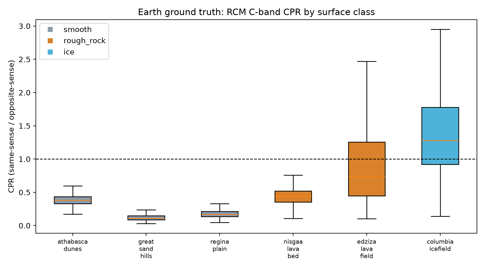
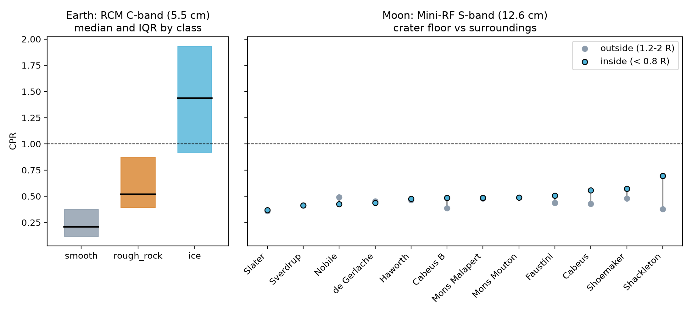
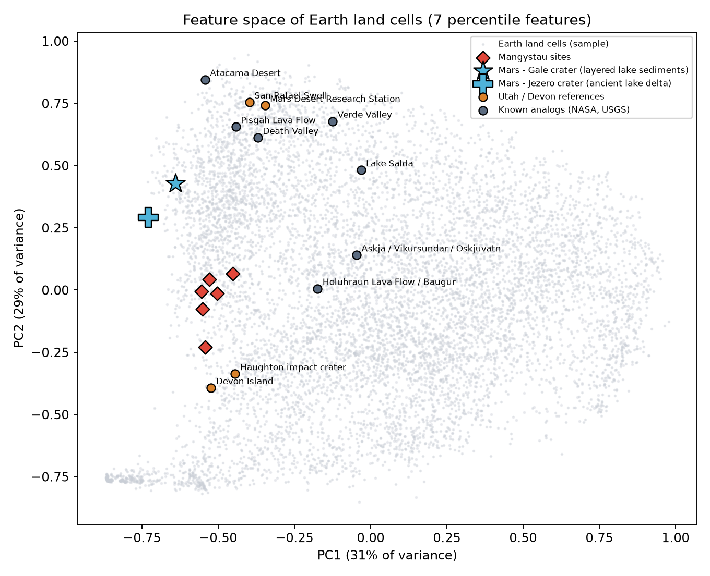

# GroundTwin: Earth as a Calibration Laboratory for Lunar Radar Ice Detection and a Multi-Criteria Search for Planetary Analogs

**Team Code Influence** (Kazakhstan) · NASA Space Apps Challenge 2026 · Code and data: https://github.com/zhureswe/groundtwin

## Abstract

High circular polarization ratio (CPR) in lunar radar images can come from water ice or from rough, rocky ground, and the interpretation of bright polar craters is still debated. GroundTwin uses Earth as a calibration laboratory. Canada's RADARSAT Constellation Mission (RCM) uses the same hybrid compact-polarimetric architecture as NASA's Mini-RF on the Lunar Reconnaissance Orbiter, so we measure CPR over Earth sites where the ground truth is known. On 8 Canadian reference sites the median CPR increases from smooth ground (0.21) to rock fields (0.52) to glacier ice (1.44). For 10 polar craters we combine Mini-RF CPR contrast, LOLA floor slope and Diviner maximum temperature into an Ice Evidence Score (0–3); 5 craters reach at least 2. A second radar test, CPR > 1 with degree of polarization (DOP) < 0.13, barely separates ice (1.69% of cells) from lava (1.20%) in C-band, while the ellipticity angle χ separates the classes better: one radar clue is not enough. We also map Earth's 60,215 land cells by similarity to the lunar south pole and to Mars, validate the map against 16 known analog sites (average rank of known Mars analogs: top 21.3% for Gale, p = 0.001; blind test: 7 of 11 recognised), and show that Mangystau in Kazakhstan, the floor of the ancient Tethys Sea, ranks in the top 9.5% of Earth for Gale crater.

## 1. Introduction

Water ice decides where a permanent lunar base can be placed: it provides drinking water, oxygen and rocket propellant. NASA has named nine candidate Artemis III landing regions near the lunar south pole (October 2024), and in 2009 the LCROSS impact into Cabeus crater detected water in the ejecta plume [Colaprete et al. 2010]. Permanently shadowed craters are cold traps: Diviner measured temperatures below about 100 K, locally near 25 K [Paige et al. 2010]; 110 K is the usual threshold below which water ice is stable for billions of years.

Radar sees into the dark craters. Mini-RF transmits a circularly polarized wave and records the same-sense (SC) and opposite-sense (OC) echoes [Raney 2007; Raney et al. 2011]. A single bounce from smooth ground reverses the sense, so CPR = σSC / σOC is low; double bounces from rocks and volume scattering in ice keep the sense, so CPR is high. Spudis et al. (2013) found "anomalous" polar craters whose CPR is high only inside the rim and interpreted them as icy; Fa and Cai (2013) and Eke et al. (2014) showed that rough slopes and rocks produce high CPR as well, also outside shadow. The debate is not settled.

Our idea is to calibrate the lunar radar against Earth, where the answer is known. RCM, launched on 12 June 2019, has a compact-polarimetry mode and openly available analysis-ready data. GroundTwin has three modules: (1) **Radar Twin** – Earth CPR classes and a multi-clue score for lunar craters; (2) **Analog Engine** – a global, transparent similarity map of Earth for Moon and Mars targets, validated on known analogs; (3) **Mars Field Twin** – Mangystau (Kazakhstan) tested against Gale and Jezero craters.

## 2. Related work

ESA's CAFE catalogue and the USGS Terrestrial Analog Data Portal list analog sites chosen by experts; NASA's Planetary Analog Explorer pairs Earth sites with planetary features. These resources say *where* analogs are, not *how similar* a place is by measurable features, and they do not search the whole planet. Image-similarity studies usually focus on one region or one feature. Mini-RF studies [Spudis et al. 2013; Fa and Cai 2013; Eke et al. 2014] debate the meaning of high CPR but have no Earth reference measured with the same radar architecture. Recently, Chandrayaan-2 DFSAR (L-band) data suggested possible subsurface ice in four doubly shadowed craters, using the criterion CPR > 1 and DOP < 0.13 [Sinha et al. 2026]. We test that criterion on Earth and on Mini-RF data.

## 3. Data

| Dataset | Agency | Use |
|---|---|---|
| RCM compact-pol CEOS-ARD (RR, RL, RRRL, local incidence angle), C-band 5.405 GHz | CSA / NRCan | Earth radar reference |
| LRO Mini-RF global mosaics, 128 ppd (CPR, M, S1, S4), S-band 2380 MHz | NASA (PDS) | Lunar CPR, DOP, χ |
| LRO Diviner Polar Resource Product (south) | NASA (PDS) | Crater maximum temperature |
| LRO LOLA polar DEM, 80 m (ldem_80s_80m) | NASA (PDS) | Crater floor slope |
| IAU Gazetteer of Planetary Nomenclature | IAU / USGS | Crater coordinates and diameters |
| GPM IMERG V07 monthly; MODIS MOD11A2, MOD13A2, MOD08_M3, MCD12Q1 | NASA (/JAXA) | Dryness, temperature, vegetation, dust, land mask |
| GMTED2010 | USGS | Terrain roughness and elevation |
| Copernicus DEM GLO-30; Sentinel-2 SR | ESA | Mangystau terrain, imagery, salt index |
| Planetary Analog Explorer; Terrestrial Analog Data Portal | NASA; USGS | Known analog sites for validation |

Earth climate features are averaged over 2015–2024 in Google Earth Engine [Gorelick et al. 2017].

## 4. Methods

### 4.1 Earth radar reference (RCM)

For each site we searched the RCM ARD catalogue for dry winter scenes and kept pixels with local incidence angle 30–60°. CPR is the ratio of block means (5 × 5 pixels) of the two circular channels. The channel convention was checked on the data: over smooth plains the median RR/RL is 0.166 < 1, so CPR = RR/RL. Classes: smooth ground (Athabasca dunes, Great Sand Hills, Regina plain), rock fields (Nisga'a and Edziza lava fields) and glacier ice (Columbia, Clemenceau, Wapta icefields; coordinates from the Canadian Geographical Names Database). For 3 planned sites (Devon Ice Cap, Haughton crater, Penny Ice Cap) no usable open scene existed.

### 4.2 Lunar targets and the Ice Evidence Score

Targets are polar craters with permanent shadow and Artemis III candidate regions anchored to IAU features (12 targets, 10 craters). For each crater we sample Mini-RF CPR inside the floor (r < 0.8 R) and in a ring outside the rim (1.2–2 R), the median LOLA slope inside, and the Diviner maximum temperature inside. The orientation of the LOLA polar grid was verified empirically (crater floors must lie below their rims). The score is

IES = [CPRin / CPRout > 1.2] + [floor slope < 8.12° (median over craters)] + [Tmax < 110 K].

It is an evidence score 0–3 meaning "consistent with ice", not a probability. Mountains (Mons Malapert, Mons Mouton) are not scored.

### 4.3 Compact-pol m-χ and DOP

From the circular channels we form Stokes parameters S0 = RR + RL, S3 = RL − RR, S1 = 2 Re⟨RR·RL\*⟩, S2 = 2 Im⟨RR·RL\*⟩; the degree of polarization is m = √(S1² + S2² + S3²)/S0 and the ellipticity angle χ follows from sin 2χ = −S3/(m S0) [Raney et al. 2012]. For Mini-RF we use the M, S1 and S4 mosaics (sin 2χ = −S4/(m S1)). We do not compute the Cloude–Pottier α angle, which needs full polarimetry. Checks: the median coherence of the RCM cross term is 0.10–0.36 (< 1), and Mini-RF CPR recomputed from S1 and S4 equals the CPR mosaic (median ratio 1.000).

### 4.4 Wavelength

RCM uses λ = 5.55 cm and Mini-RF λ = 12.6 cm. The Rayleigh smoothness threshold h = λ / (8 cos θ) is 0.80–1.39 cm for RCM at 30–60° and 2.35 cm for Mini-RF at 48°. Because the two radars sense different roughness scales and depths, we compare the **order** of classes and the inside/outside contrast, not absolute CPR values. This is an approximate calibration; we do not claim any C-to-S conversion factor.

### 4.5 Analog Engine

Earth's land (60°S–90°N, Antarctica excluded) is divided into 0.5° cells (60,215 cells). Seven features are converted to percentiles p ∈ [0, 1] over all land cells in the "extreme" direction: dryness (GPM), absence of vegetation (MODIS NDVI), day–night temperature swing and cold nights (MODIS LST), dust (MODIS AOD), terrain roughness and elevation (GMTED2010). Missing dust values (2,464 cells) are set to a neutral 0.5. Each target has a profile t and each mission mode weights w (Science, Rover operations, Base construction, Ice & resources; all published in `targets.json`):

si = 1 − |pi − ti|,  S = Σ wi si / Σ wi.

### 4.6 Validation

Known analogs (16 sites from the NASA Planetary Analog Explorer, the USGS portal, and reference sites MDRS, San Rafael Swell, Devon Island and Haughton) are mapped to grid cells. Lift = (share of known-site cells in the top 10%) / 0.10, with a p-value from 1000 random cell sets of the same size. Because Lift uses few cells, we also report the average rank of known sites (random ≈ 50%) with its permutation p-value. In a blind leave-one-out test each known cell is hidden, a profile is built from the other cells (mean percentiles, equal weights), and the hidden cell counts as recognised if it ranks in the top 10% (binomial p-value).

## 5. Results

### 5.1 Earth radar ruler

| Class | Median CPR | 25–75% | Share CPR > 1 | Cells |
|---|---|---|---|---|
| Smooth ground | 0.21 | 0.12–0.38 | 0.3% | 4655 |
| Rock fields | 0.52 | 0.39–0.87 | 21.7% | 916 |
| Glacier ice | 1.44 | 0.92–1.93 | 71.0% | 2128 |

The order smooth < rock < ice holds; the three icefields have median CPR 1.28 (Columbia), 1.72 (Clemenceau) and 0.94 (Wapta).

### 5.2 Lunar craters

5 of 10 craters have IES ≥ 2: Shackleton, Haworth, Shoemaker, Cabeus, Cabeus B. Shackleton has CPR 0.69 inside vs 0.38 outside (ratio 1.84), Tmax 93 K and IES 2. Cabeus has a radar contrast of 1.30 but a median Tmax of 225 K, so it fails the cold clue, although 17% of its floor stays below 110 K and LCROSS found water there (Section 6). The scoring rule was fixed before the results and was not changed. All lunar floor CPR values (0.37–0.69) are below the median of Earth glacier ice; they overlap the Earth smooth-ground and rock-field ranges, which is why the inside/outside contrast and the other clues matter more than the absolute value.

| Target | CPR in / out | Floor slope | Tmax (median) | Floor < 110 K | IES |
|---|---|---|---|---|---|
| Shackleton | 0.69 / 0.38 | 9.5° | 93 K | 93% | 2 |
| Haworth | 0.48 / 0.46 | 6.9° | 65 K | 75% | 2 |
| Shoemaker | 0.57 / 0.48 | 7.3° | 71 K | 80% | 2 |
| Faustini | 0.51 / 0.44 | 9.0° | 75 K | 76% | 1 |
| Cabeus | 0.56 / 0.43 | 4.5° | 225 K | 17% | 2 |
| de Gerlache | 0.44 / 0.45 | 6.9° | 121 K | 49% | 1 |
| Sverdrup | 0.41 / 0.41 | 11.9° | 96 K | 66% | 1 |
| Nobile | 0.42 / 0.49 | 10.0° | 239 K | 9% | 0 |
| Cabeus B | 0.49 / 0.39 | 4.4° | 238 K | 19% | 2 |
| Mons Malapert | 0.49 / 0.48 | 4.6° | 262 K | 1% | n/a |
| Mons Mouton | 0.49 / 0.49 | 6.5° | 264 K | 1% | n/a |
| Slater | 0.37 / 0.36 | 11.2° | 77 K | 62% | 1 |

Tmax is the median of the Diviner annual maximum temperature over the floor zone (r < 0.8 R); "Floor < 110 K" is the share of those floor samples whose annual maximum stays below 110 K (shown, not scored).

### 5.3 One radar clue is not enough

Share of cells passing CPR > 1 and DOP < 0.13: in RCM C-band, glacier ice 1.69%, lava/rock fields 1.20%, smooth ground 0.04%. The criterion barely separates ice from lava. On the Moon (Mini-RF S-band), the floor of Shackleton passes in 0.72% of samples vs 0.16% outside the rim, and Faustini in 0.58% vs 0.37%. The ellipticity angle separates the Earth classes better (median χ: smooth -41°, rock -28°, ice 9°), but χ is linked to CPR and is not a fully independent clue. The criterion was developed for L-band, so these shares are an order, not calibrated values. Our conclusion is that a single radar number cannot distinguish ice from rough rock, which supports combining radar contrast, floor smoothness and temperature.

### 5.4 Analog Engine and validation

Top 5 cells by formula (Science mode, at least 600 km apart). Moon south pole: Xinjiang Uygur Zizhiqu, China (36.75°N, 85.75°E, S = 0.925); Xinjiang Uygur Zizhiqu, China (35.75°N, 78.25°E, S = 0.907); Qinghai Sheng, China (38.75°N, 94.75°E, S = 0.906); Govi-Altai, Mongolia (46.25°N, 95.25°E, S = 0.903); Xinjiang Uygur Zizhiqu, China (42.25°N, 88.75°E, S = 0.901). Mars - Gale crater (layered lake sediments): Xinjiang Uygur Zizhiqu, China (40.25°N, 86.75°E, S = 0.941); Illizi, Algeria (27.25°N, 6.75°E, S = 0.926); Nei Mongol Zizhiqu, China (41.25°N, 101.75°E, S = 0.923); Red Sea, Egypt (25.25°N, 33.75°E, S = 0.923); Bechar, Algeria (29.75°N, 0.75°W, S = 0.920).

Lift in the top 10% is weak (Science mode): Moon ×2.00 (p = 0.4256, 5 cells), Gale ×0.91 (p = 0.6753), Jezero ×0.00 (p = 1.0); for Gale in Base-construction mode ×2.73 (p = 0.0979). Many known analogs are volcanic Icelandic sites rather than deserts. The average rank of known Mars analogs is clearly better than random: top 21.3% for Gale (p = 0.001) and top 24.4% for Jezero (p = 0.003); for the Moon top 33.7% (p = 0.1089). In the blind test, 7 of 11 Mars-analog cells were recognised (chance ≈ 1.1, p = 2e-05, median rank top 5.7%), and 8 of 13 for all analogs (p = 1e-05). Several known Mars analogs cluster in the US Southwest, which makes them easier to recognise from each other.

Training references, with their honest rank (not inserted into the top 5): Cinder Lake Crater Field, built by the USGS for Apollo training [USGS], S = 0.68, cosine 0.95, rank #16,161 (top 26.8%); Meteor Crater S = 0.76, cosine 0.95, rank #7,410 (top 12.3%) (Moon target). MDRS S = 0.77, cosine 0.91, rank #8,471 (top 14.1%); San Rafael Swell S = 0.78, cosine 0.91, rank #7,644 (top 12.7%) (Gale). Cinder Lake was chosen for crater geology, which our climate and terrain features do not measure.

### 5.5 Mangystau as a Mars field twin

Mangystau combines layered Tethys Sea sediments (Bozzhyra, Sherkala), salt flats (Tuzbair sor), sandstone concretions (Torysh) and depressions below sea level: the lowest DEM pixel in the Karagiye buffer is -134 m (the reference value is about −132 m) and in Karynzharyk -70 m. Regional means: 184 mm of rain per year, maximum NDVI 0.18, day–night surface temperature swing 18.4 K. The approximate Sentinel-2 salt index ranges from 0.05 to 0.23 and is highest in the depressions and sors. Mangystau ranks in the top 9.5% of Earth's land cells for Gale and 8.3% for Jezero.

| Place | Gale S | Gale cosine | Gale rank | Jezero S | Jezero cosine | Jezero rank |
|---|---|---|---|---|---|---|
| Mangystau (6 sites) | 0.82 | 0.97 | top 9.5% | 0.84 | 0.98 | top 8.3% |
| Mars Desert Research Station (Utah) | 0.77 | 0.91 | top 14.1% | 0.73 | 0.86 | top 20.6% |
| San Rafael Swell (Utah) | 0.78 | 0.91 | top 12.7% | 0.75 | 0.87 | top 17.9% |
| Devon Island | 0.76 | 0.89 | top 16.0% | 0.78 | 0.90 | top 13.7% |
| Haughton impact crater | 0.79 | 0.90 | top 12.1% | 0.77 | 0.89 | top 14.7% |

Mangystau is closer to both Mars profiles than the Utah and Devon references by all three measures. A PCA of the seven features (PC1 31%, PC2 29% of variance) shows the same picture. The analogy has limits: Torysh concretions are metres across and made of sandstone, while Opportunity's spherules in Meridiani are millimetres across and made of hematite [Squyres et al. 2004]; Tethys was a sea, whereas Gale held lakes [Grotzinger et al. 2014, 2015]; and Earth has air, warmth and life. We found no scientific study of Mangystau as a Mars analog, only travel writing.

## 6. Limitations

- Earth cannot reproduce lunar or Martian gravity, vacuum or the thin Martian air, space radiation, or sharp, unweathered lunar regolith.
- RCM (C-band) and Mini-RF (S-band) have different wavelengths and penetration depths; we compare order and contrast only, and the calibration is approximate.
- Earth glacier ice is cleaner than ice mixed into lunar regolith, and moisture changes the radar echo; we use dry winter scenes.
- The cold clue uses the median annual maximum temperature over the whole floor zone, which can include sunlit slopes: Cabeus has a median Tmax of 225 K, yet 17% of its floor stays below 110 K, and LCROSS (2009) found water in Cabeus. A cold-floor share may be a better clue in future work.
- Three planned Arctic references had no usable open RCM scene.
- The 0.5° grid is coarse; GroundTwin is a screening tool, not a replacement for field work. Some dust values are imputed.
- Target profiles and mode weights are our choices; they are published and editable.
- Validation Lift is weak; the average-rank and blind tests are stronger, but known Mars analogs are geographically clustered.

## 7. Future work

An S-band Earth reference from NISAR (NASA–ISRO), whose wavelength is close to Mini-RF; more reference sites and craters; a radar twin for Mars; field checks in Mangystau with a scientific partner; a Kazakh and Russian version for schools; and a version of this paper with a DOI.

## 8. Data and code availability

All code (Python pipeline `pipeline/01–12`) and the derived JSON files are open under the MIT licence at https://github.com/zhureswe/groundtwin; the website in `/docs` reads only these files. Every number in this paper is substituted from them by `pipeline/12_paper.py`, which also writes the list `paper/numbers.md`. RADARSAT Constellation Mission Imagery © Government of Canada (2025); RADARSAT is an official mark of the Canadian Space Agency. GroundTwin is not endorsed by NASA or any space agency.

## 9. AI use statement

We used Claude (Anthropic) via Claude Code to help write Python and HTML/JavaScript code, debug, and edit English text, including drafting this paper from our computed data. The project concept (using RCM as an Earth calibration twin for Mini-RF), site selection, data checks, interpretation of results and the visual design are our own. No AI-generated images or videos are used; all figures are plots of our data.

## References

- Colaprete, A., et al. (2010). Detection of water in the LCROSS ejecta plume. *Science*, 330, 463–468. doi:10.1126/science.1186986
- Eke, V. R., et al. (2014). Lunar polar craters – icy, rough or just sloping? *Icarus*, 241, 66–78. doi:10.1016/j.icarus.2014.06.021
- Fa, W., & Cai, Y. (2013). Circular polarization ratio characteristics of impact craters from Mini-RF observations and implications for ice detection at the polar regions of the Moon. *JGR Planets*, 118, 1582–1608. doi:10.1002/jgre.20110
- Gorelick, N., et al. (2017). Google Earth Engine: Planetary-scale geospatial analysis for everyone. *Remote Sensing of Environment*, 202, 18–27. doi:10.1016/j.rse.2017.06.031
- Grotzinger, J. P., et al. (2014). A habitable fluvio-lacustrine environment at Yellowknife Bay, Gale crater, Mars. *Science*, 343, 1242777. doi:10.1126/science.1242777
- Grotzinger, J. P., et al. (2015). Deposition, exhumation, and paleoclimate of an ancient lake deposit, Gale crater, Mars. *Science*, 350, aac7575. doi:10.1126/science.aac7575
- NASA (2024). NASA provides update on Artemis III Moon landing regions. https://www.nasa.gov/news-release/nasa-provides-update-on-artemis-iii-moon-landing-regions/
- Paige, D. A., et al. (2010). Diviner Lunar Radiometer observations of cold traps in the Moon's south polar region. *Science*, 330, 479–482. doi:10.1126/science.1187726
- Raney, R. K. (2007). Hybrid-polarity SAR architecture. *IEEE Trans. Geosci. Remote Sens.*, 45, 3397–3404. doi:10.1109/TGRS.2007.895883
- Raney, R. K., et al. (2011). The lunar Mini-RF radars: Hybrid polarimetric architecture and initial results. *Proc. IEEE*, 99, 808–823. doi:10.1109/JPROC.2010.2084970
- Raney, R. K., et al. (2012). The m-chi decomposition of hybrid dual-polarimetric radar data with application to lunar craters. *JGR Planets*, 117(E12). doi:10.1029/2011JE003986
- Sinha, R. K., et al. (2026). Subsurface ice in doubly shadowed craters as revealed by Chandrayaan-2 dual frequency synthetic aperture radar. *npj Space Exploration*, 2, 22. doi:10.1038/s44453-026-00038-9
- Smith, D. E., et al. (2010). Initial observations from the Lunar Orbiter Laser Altimeter (LOLA). *Geophys. Res. Lett.*, 37(18). doi:10.1029/2010GL043751
- Spudis, P. D., et al. (2013). Evidence for water ice on the Moon: Results for anomalous polar craters from the LRO Mini-RF imaging radar. *JGR Planets*, 118, 2016–2029. doi:10.1002/jgre.20156
- Squyres, S. W., et al. (2004). In situ evidence for an ancient aqueous environment at Meridiani Planum, Mars. *Science*, 306, 1709–1714. doi:10.1126/science.1104559
- USGS. Cinder Lake Crater Field uncrewed aerial system-derived digital elevation models 2023 and 2024 (data release). https://catalog.data.gov/dataset/cinder-lake-crater-field-uncrewed-aerial-system-derived-digital-elevation-models-2023-2024-f516d
- Data portals: NASA Planetary Analog Explorer https://science.nasa.gov/solar-system/analog-explorer/ · USGS Terrestrial Analog Data Portal https://tadp.astrogeology.usgs.gov · RCM CEOS-ARD https://registry.opendata.aws/rcm-ceos-ard/ · PDS Geosciences LRO https://pds-geosciences.wustl.edu/missions/lro/ · IAU Gazetteer https://planetarynames.wr.usgs.gov
